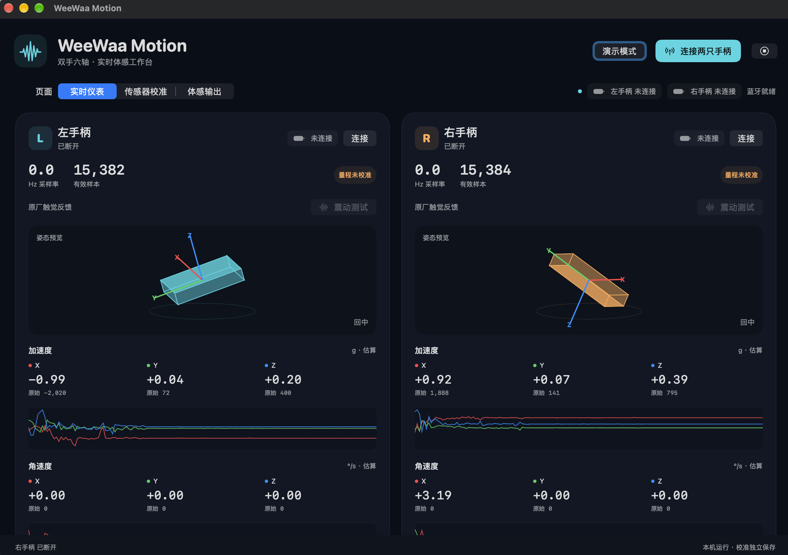
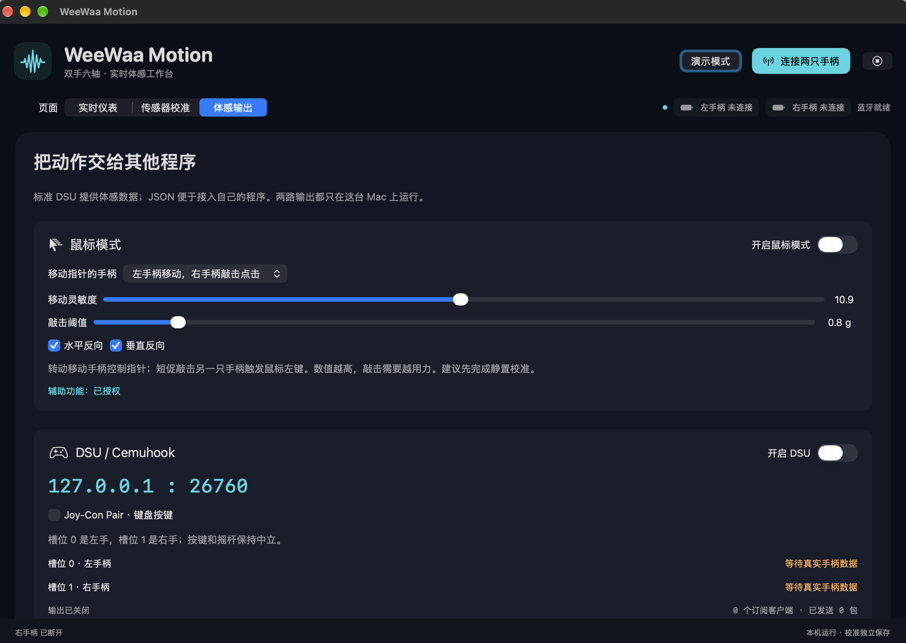

# OpenWeewaaMotion

WeeWaa Motion 是一款 macOS 原生工具，可连接 WeeWaa 左右手柄，查看六轴体感数据，并将动作发送给其他应用。

## 界面预览

**双手实时仪表**



**鼠标模式与体感输出**



## 功能

- **鼠标模式**：选择一只手柄通过转动移动指针，另一只手柄通过短促敲击触发鼠标左键；支持调整灵敏度、敲击阈值和方向。
- **实时仪表与校准**：查看左右手柄的加速度、角速度、电量和姿态预览，分别保存传感器校准参数。
- **体感输出**：通过本机 DSU / Cemuhook 或 JSON UDP 向兼容程序提供运动数据。
- **震动回传**：通过本机 UDP 接收震动指令，并支持 nxnative 接入补丁。

## 推荐玩法

在搭载 Apple M 系列芯片的 MacBook 上，使用 WeeWaa Motion 连接左右手柄，配合 Astris 体验《有氧拳击 3》。在 WeeWaa Motion 中开启 DSU 体感输出，并在 Astris 中配置相应输入；具体兼容性、按键映射和体感效果以实际体验为准。

## 下载与安装

从 [Releases](https://github.com/kawabonka/OpenWeewaaMotion/releases) 下载最新版本，解压后打开 `WeeWaa Motion.app`。需要 macOS 14 或更高版本。发布包为本机构建、临时签名的应用，未经过 Apple 公证；当前发布包的处理器架构请参见对应 Release 说明。

也可以从源码构建：

```sh
git clone https://github.com/kawabonka/OpenWeewaaMotion.git
cd OpenWeewaaMotion
bash NativeApp/build.sh
open 'dist/WeeWaa Motion.app'
```

构建需要 macOS 和 Apple Command Line Tools，不需要 Python。

## 开始使用

1. 开启左右手柄，并退出可能正在连接它们的 iPad 原厂 App。
2. 打开 WeeWaa Motion，允许蓝牙访问，然后点击“连接两只手柄”。
3. 在“实时仪表”查看数据；建议在“传感器校准”中先完成静置校准。
4. 在“体感输出”开启需要的功能。

### 鼠标模式

在“体感输出”开启鼠标模式，选择控制指针的手柄。转动这只手柄移动指针，短促敲击另一只手柄触发左键。可根据握持方式调整灵敏度、敲击阈值以及水平和垂直方向。

首次使用时，请在 macOS“系统设置 → 隐私与安全性 → 辅助功能”中允许 WeeWaa Motion，然后重新开启鼠标模式。鼠标模式尚未经过真实手柄体验验证，可能需要调整设置。

### 连接其他应用

- DSU / Cemuhook：`127.0.0.1:26760`，默认左、右手分别为槽位 0、1。接收端需要支持 DSU。
- JSON UDP：`127.0.0.1:8765`。
- 游戏震动回传：`127.0.0.1:8766`，映射为固定短震动效果。

未完成完整校准时，物理单位使用估算值；演示数据不会发送到输出接口。DSU 提供运动数据，不会让系统将手柄识别为完整游戏手柄。

## 更多文档

- [App 使用、校准和输出说明](NativeApp/README.md)
- [nxnative 双向接入说明](nxnative_integration/README.md)
- [体感与震动接入方案](docs/WeeWaa体感与震动接入nxnative实施方案.md)
