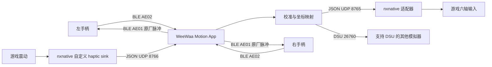

# WeeWaa 双手体感与震动接入 nxnative 实施方案

版本：v0.1 · 日期：2026-11-12 · 平台：macOS

## 1. 目标与当前结论

将 WeeWaa 左右手柄作为 Mac 的外部体感设备，提供六轴演示、校准、游戏体感输入与震动反馈。

硬件链路已经打通：两只手柄能同时向原生 Mac App 发送约 83 Hz 的六轴原始数据；左右手的固定震动效果也已经由用户确认。nxnative 的源码接入补丁已准备，模块与双向通信测试通过，具体游戏仍需重新构建和实测。

本方案采用 **WeeWaa Motion App 管理硬件，nxnative 适配器连接游戏接口** 的结构。第一阶段交付六轴与固定脉冲震动；按键、摇杆以及精确 HD Rumble 不包含在第一阶段中。

## 2. 已有成果与证据

| 能力 | 当前状态 | 证据 / 边界 |
| --- | --- | --- |
| 右手 Mac 直连采集 | 已实测 | 1,663 个运动包，约 83.25 Hz |
| 左手 Mac 直连采集 | 已实测 | 2,498 个运动包，约 83.31 Hz |
| 原生 App 双手同时连接 | 已实测 | 两手各约 83 Hz，电量、波形与姿态预览正常 |
| 原生 App 双手 JSON 输出 | 已实测 | 两秒收到左手 167 包、右手 166 包 |
| 静置零偏校准 | 两手已完成 | 已保存，并验证重启加载 |
| 六面与转角校准功能 | 已实现，计算测试通过 | 用户手柄的完整量程校准尚未完成 |
| 固定震动效果 | 两手已实测 | 用户确认短震并自动停止；左手验证了 UDP → App → BLE 路径 |
| DSU 标准体感输出 | 协议测试通过 | 独立客户端验证双槽位、CRC、数据布局；未进行具体模拟器游戏实测 |
| nxnative 适配器 | 源码与模块测试通过 | 补丁检查、API 编译、单位转换、双向 UDP 验证通过 |
| nxnative 游戏内使用 | 待实施 | 尚未构建目标游戏、验证体感方向及游戏震动 |

原始记录与操作细节见 [协议与采集说明](../README.md)、[App 使用说明](../NativeApp/README.md)、[nxnative 接入说明](../nxnative_integration/README.md)。上述测试不代表已完成游戏兼容性认证。

## 3. 总体架构



所有 UDP 接口只绑定或发送到 `127.0.0.1`。App 独占维护手柄的连接、初始化和保活；游戏通过本机协议读写，不另行争抢蓝牙连接。

| 接口 | 方向 | 用途 |
| --- | --- | --- |
| BLE AE02 | 手柄 → App | 连续六轴通知 |
| BLE AE01 | App → 手柄 | 原厂初始化、保活及固定震动效果 |
| JSON UDP 8765 | App → nxnative 适配器 | 左右手六轴、时间戳、校准状态 |
| JSON UDP 8766 | nxnative 适配器 → App | 左右手震动请求 |
| DSU UDP 26760 | App ↔ DSU 客户端 | 其他兼容模拟器的体感输入 |

JSON 8765 的接收端由 nxnative 适配器占用；验证工具和其他接收程序不要同时绑定该端口。nxnative 本方案走双向 JSON，不能仅开启 DSU 就假定现成 nxnative 游戏可直接使用。

## 4. 硬件协议与震动策略

### 六轴

业务服务为 AE30。AE01 支持 Write without Response，AE02 支持 Notify。原厂初始化与保活序列已复现；连续运动通知为 19 字节：

| 偏移 | 长度 | 当前解释 |
| --- | --- | --- |
| 0 | 3 | 固定前缀 `11 06 00` |
| 3 | 4 | 小端计数，通常每包增加 12 |
| 7 | 6 | 三个小端有符号 16 位通道，加速度候选 |
| 13 | 6 | 三个小端有符号 16 位通道，角速度候选 |

通道的物理量程及握持坐标需要通过完整校准确认。初始化中出现的 `-32768` 当前作为无效读数处理。

### 震动

已确认向 AE01 写入以下原厂指令可触发短震，随后自动停止：

```text
82 50 96 96
```

证据包括原厂训练抓包、右手直接回放、左手经 App 回传，以及用户对两手触觉效果的确认。各字节的强度、频率、时长含义尚未确定。

第一版的映射策略：

- 游戏左马达对应左手，右马达对应右手。
- 非零效果以固定原厂脉冲近似，同一手柄最多每秒 4 次；当前小于等于 0.05 的请求不触发。
- 持续震动由适配器周期性回传，App 仍逐次发送有限脉冲。
- 停止请求不再触发新脉冲，已触发的脉冲自行结束。
- 演示模式、手柄未连接或该手柄正在校准时，不触发硬件震动。

因此，本版可实现事件反馈和持续效果的脉冲近似，尚不能忠实还原 Switch HD Rumble 的幅度、频率和包络。

## 5. 校准与坐标转换

左右手分别校准和保存，顺序如下：

1. **静置 3 秒**：估计三轴陀螺仪零偏；移动过大则拒绝保存。两手已完成。
2. **六面采集**：依次完成 X+、X−、Y+、Y−、Z+、Z−，计算加速度各轴偏置和 count/g。
3. **三轴已知转角**：每轴分别单方向转动已知的 90° 或 180°，通过积分确定 count/(°/s)。
4. **握持坐标映射**：确认输出 X 为右、Y 为前、Z 为上，按实际握持调整排列与方向。

DSU 和 nxnative 适配器只使用完整校准后的真实数据。未完成时，App 的物理单位标为估算，JSON 的 `calibrated` 为 `false`。

进入 nxnative 时：

- 加速度从 App 的比力方向取负，转换为主机要求的重力方向，静放参考为 `(0, 0, -1)` g。
- 角速度从 °/s 转换为 rad/s。
- App 时间戳用于每手排序、去重；主机采样时间使用 nxnative 自身接收时钟，不保留传输前的精确采样时间。
- 500 ms 没有新数据时清除对应体感源；航向没有绝对参考，仍需允许回中。

## 6. nxnative 接入设计

基线为官方提交 `0c078130f6db7d0d32c1dc28146feaf97713f008`。

| 接入点 | 实现方式 |
| --- | --- |
| 左右手独立传感器 | `dm_motion_set_joy(player, side, …)` |
| 普通单传感器输入 | `dm_motion_set_hid(player, …)`；优先右手，右手不在时回退左手 |
| 游戏震动输出 | `dm_haptics_apple_set_sink(player, …)` 接收左右马达状态 |
| 焦点变化 | Mac 前端暂停 / 恢复桥接体感；震动沿用主机的暂停与增益处理 |
| 输入源选择 | 对选定玩家暂停其他 GameController / Pro HID 的体感发布，保留普通按键输入 |

默认接入玩家 1。`DM_WEEWAA_JOYPAIR=1` 是可选实验模式，用于声明一对 Joy-Con，仍需按目标游戏实测。不与同一玩家的 Switch 2 自定义震动路由混用。

源码补丁已提供版本检查，避免直接套用到接口不同的 nxnative 版本：

- [适配器源码](../nxnative_integration/weewaa_bridge.h)
- [标准补丁](../nxnative_integration/nxnative-weewaa.patch)
- [检查与应用脚本](../nxnative_integration/apply_patch.py)
- [版本清单](../nxnative_integration/manifest.json)

具体应用命令见 [nxnative 接入说明](../nxnative_integration/README.md)。补丁需要编入 Mac 游戏主机并重新打包，当前没有修改现成游戏 App。

## 7. 分阶段实施与验收

以下阈值为后续建议的验收目标，不是已经测得的成绩。

| 阶段 | 工作 | 通过条件 |
| --- | --- | --- |
| A · 完整校准 | 两手完成六面、三轴转角和握持映射 | 参数分别保存；重启恢复；稳定静放约 1 g；已知转角误差争取控制在 10% 内 |
| B · 构建接入 | 核对用户实际源码版本、游戏标题 ID、原有构建流程 | 补丁可审查；新主机编译、链接、打包成功；游戏正常启动 |
| C · 单手体感 | 先用右手驱动普通单传感器场景，按键由键盘或标准手柄提供 | 方向正确、无明显漂移或跳变；稳定阶段每手平均至少 75 Hz；断连后不继续发布旧动作 |
| D · 双手体感 | 验证左右传感器与可选 Joy-Con 配对模式 | 左右动作互不串线；游戏实际读取到对应传感器；单手断连后的行为符合设计 |
| E · 游戏震动 | 验证碰撞、命中、持续效果、停止和切换焦点 | 左右马达路由正确；停止后无新脉冲；失焦或退出后无持续重复触发 |
| F · 兼容性记录 | 为每个游戏记录版本、模式、设置、结果 | 保留可复现操作、日志和已知限制，按游戏逐项标记通过 |

首次游戏验证应选择已知有明确体感动作和离散震动事件的场景；在游戏版本明确后再选择具体标题。物理延迟尚未测量，应分别记录主机回调、UDP 到达与 BLE 写入时间；真实触觉延迟需要额外测量，不能由通信测试推算。

## 8. 验证范围与回退

已通过的适配器测试涵盖：真实 API 声明下的编译、数据格式、左右路由、校准标记、重复 / 乱序拒绝、单位转换、焦点暂停，以及双向 UDP 和停止状态回传。

尚缺完整游戏主机链接与真实游戏验证。六面和转角的计算测试通过，也不替代用户手柄的物理校准。

回退方式：关闭 App 的游戏震动回传和 JSON 输出；从游戏配置移除 `DM_WEEWAA=1`。如需完全移除接入，恢复未打补丁的前端源码并用原流程重建。原有独立采集和 DSU 功能可继续使用。

## 9. 下一阶段所需资料

实际实施时再确认：

- 用户正在使用的 nxnative 源码版本与目录。
- 目标游戏、版本、标题 ID，以及现有构建 / 打包输出目录。
- 游戏启动方式、按键输入设备，以及希望优先验证的体感动作。

本轮先形成方案，不继续修改游戏、不开始新的硬件测试。

## 10. 参考与交付索引

- [原生 WeeWaa Motion App](../dist/WeeWaa%20Motion.app)
- [App 操作说明](../NativeApp/README.md)
- [nxnative 接入与命令说明](../nxnative_integration/README.md)
- [右手震动实测记录](../rumble-right-replay.json)
- [左手回传实测记录](../rumble-left-feedback.json)
- [nxnative 官方六轴接口](https://github.com/seedds/nxnative/blob/0c078130f6db7d0d32c1dc28146feaf97713f008/dm/host/dm_input.h)
- [nxnative 官方震动 sink 接口](https://github.com/seedds/nxnative/blob/0c078130f6db7d0d32c1dc28146feaf97713f008/dm/host/haptics_apple.h)

